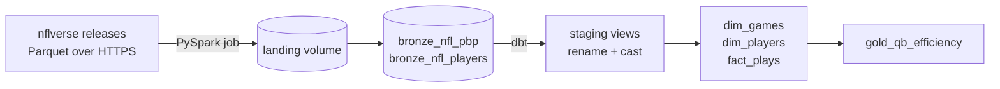
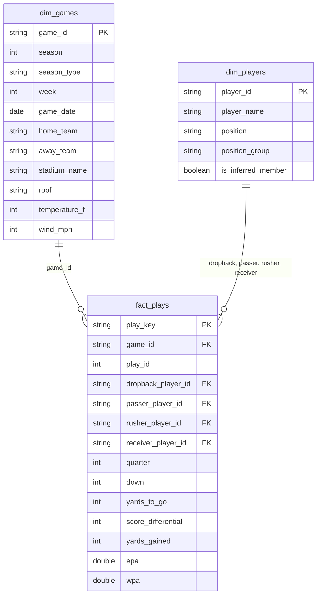

# GridironLakehouse

A medallion lakehouse for NFL play-by-play on Databricks. It ingests the open
[nflverse](https://github.com/nflverse/nflverse-data) data with PySpark, models it
as a Kimball star schema with dbt Core, and publishes a quarterback efficiency
feature table.



| Layer | Built by | Objects |
|---|---|---|
| Bronze | `ingestion/bronze_ingest_nflverse.py` | `bronze_nfl_pbp` (partitioned by season), `bronze_nfl_players` |
| Staging | dbt views | `stg_nflverse__plays`, `stg_nflverse__players` |
| Silver | dbt tables | `dim_games`, `dim_players`, `fact_plays` |
| Gold | dbt table | `gold_qb_efficiency` |

## Repository layout

```
ingestion/
  bronze_ingest_nflverse.py      PySpark job: nflverse -> landing volume -> Delta
transform/                       dbt project
  dbt_project.yml                layers, schemas, materializations, vars
  profiles.yml                   SQL Warehouse connection, secrets from env vars
  packages.yml                   dbt_utils
  macros/                        schema naming, flag casting, safe ratio
  models/staging/                sources.yml + rename/cast views
  models/silver/                 star schema + schema.yml (tests and docs)
  models/gold/                   gold_qb_efficiency + schema.yml
  tests/                         bronze-to-fact reconciliation test
requirements.txt                 dbt-databricks
```

## Prerequisites

- A Databricks workspace with Unity Catalog and a SQL Warehouse.
- A catalog dedicated to this project, so its `bronze`, `silver` and `gold`
  schemas cannot collide with another project's. The defaults use `gridiron`.
  Create it once in the SQL editor:

  ```sql
  CREATE CATALOG IF NOT EXISTS gridiron;
  ```

  To use another name, pass it as `--catalog` to the job and set
  `DATABRICKS_CATALOG` for dbt. Both must name the same catalog.
- Compute for the ingestion job with outbound HTTPS access to `github.com` and
  `release-assets.githubusercontent.com` (release downloads redirect there).
- Python 3.10 or newer on your machine for dbt (tested with 3.12).

## Step 1. Bronze: ingest nflverse

1. Push this repository to GitHub and add it to the workspace as a Git folder.
2. Create a job with one **Python script** task that points at
   `ingestion/bronze_ingest_nflverse.py`, with these parameters:

   ```json
   ["--catalog", "gridiron", "--schema", "bronze", "--start-season", "2020", "--end-season", "2026"]
   ```

3. Run it. It creates the schema, a `landing` volume and both bronze tables.

What the job does:

- **Downloads** each season file to the driver, verifies it is a complete Parquet
  file (size and magic bytes), then copies it into the landing volume. Spark
  cannot read from HTTPS directly.
- **Infers the schema** from the Parquet footers. nflverse changes physical types
  between seasons (`goal_to_go` is INT32 in 2021-2023 and DOUBLE elsewhere), so
  each season is read separately and widened to one common schema.
- **Adds audit columns**: `_ingested_at`, `_ingest_run_id`, `_source_file`.
- **Writes Delta partitioned by `season`**, replacing only the seasons it loaded
  (`replaceWhere`). Re-running is always safe.

For the weekly in-season refresh, schedule the same task with
`--start-season 2026 --end-season 2026`. A season that nflverse has not published
yet is skipped with a warning.

Check the load:

```sql
select season, count(*) as plays, max(_ingested_at) as loaded_at
from gridiron.bronze.bronze_nfl_pbp
group by season
order by season;
```

A completed season has roughly 48,000 to 50,000 rows.

## Step 2. Connect dbt Core to the SQL Warehouse

```bash
python -m venv .venv
source .venv/bin/activate            # PowerShell: .venv\Scripts\Activate.ps1
pip install -r requirements.txt
```

`transform/profiles.yml` holds no secrets. Set the connection details as
environment variables. The host and HTTP path are on the warehouse's
**Connection details** tab.

```bash
export DATABRICKS_HOST="dbc-a1b2c3d4-e5f6.cloud.databricks.com"   # no https://
export DATABRICKS_HTTP_PATH="/sql/1.0/warehouses/1234567890abcdef"
export DATABRICKS_TOKEN="<personal access token>"
export DATABRICKS_CATALOG="gridiron"                               # optional, this is the default
```

```powershell
$env:DATABRICKS_HOST = "dbc-a1b2c3d4-e5f6.cloud.databricks.com"
$env:DATABRICKS_HTTP_PATH = "/sql/1.0/warehouses/1234567890abcdef"
$env:DATABRICKS_TOKEN = "<personal access token>"
```

Then, from the `transform/` directory:

```bash
cd transform
dbt deps      # install dbt_utils
dbt debug     # confirm the connection
```

## Step 3. Build silver and gold

```bash
dbt build                    # dev target
dbt build --target prod      # production schemas
```

`dbt build` runs models and tests together in dependency order: source tests,
staging, dimensions and fact, their tests, then gold. Anything downstream of a
failed test is skipped.

The target decides the schema names (`macros/generate_schema_name.sql`):

| Target | Staging | Silver | Gold |
|---|---|---|---|
| `dev` (default) | `dev_staging` | `dev_silver` | `dev_gold` |
| `prod` | `staging` | `silver` | `gold` |

Useful selections:

```bash
dbt build --select silver                 # one layer
dbt build --select fact_plays+            # a model and everything downstream
dbt test --select source:nflverse         # raw-data checks only
dbt source freshness                      # warn if bronze is more than 8 days old
dbt build --select gold_qb_efficiency --vars '{qb_rolling_window_games: 6}'
dbt docs generate && dbt docs serve       # lineage graph and data dictionary
```

## The star schema



| Model | Grain | Materialization |
|---|---|---|
| `dim_games` | one row per game | table |
| `dim_players` | one row per player (Type 1) | table |
| `fact_plays` | one row per play | incremental merge on `play_key`, partitioned by `season` |

Design decisions:

- **Keys.** `game_id` and the GSIS `player_id` are stable, single-source business
  keys, so the dimensions use them directly. `play_id` is only unique within a
  game, so the fact gets a surrogate `play_key` hashed from `game_id` and `play_id`.
- **Role-playing player keys.** `fact_plays` points at `dim_players` once per role.
  A key is NULL when the role does not apply to the play.
- **Positions come from a second source.** Play-by-play has player ids and short
  names but no positions, which is why the job also loads the nflverse player
  master.
- **Inferred members.** If a play references a player the master does not list
  yet, `dim_players` creates a placeholder row from the play data so the foreign
  key still resolves. A warning-level test reports when that happens.
- **Pass attempts are derived.** The raw `pass_attempt` flag counts sacks.
  `is_pass_attempt` is completions + incompletions + interceptions, which matches
  official statistics. Spikes count as attempts but are not dropbacks.
- **Incremental fact.** Each run merges the rows whose `_ingested_at` is newer than
  anything already in the fact. A republished season is upserted in place.

## Gold: `gold_qb_efficiency`

One row per quarterback per game. Each metric exists at three scopes:

| Prefix | Scope |
|---|---|
| none | this game |
| `season_` | season to date, through this game |
| `rolling_` | the quarterback's last 4 games of the season (`qb_rolling_window_games`) |

| Metric | Column suffix | Definition |
|---|---|---|
| Total dropbacks | `dropbacks` | passes thrown + sacks + scrambles |
| Passing yards | `passing_yards` | yards on completed passes |
| Completion percentage | `completion_pct` | completions / pass attempts x 100 |
| TD-to-INT ratio | `td_int_ratio` | passing touchdowns / interceptions, NULL with no interception |
| EPA per play on 3rd and 4th down | `late_down_epa_per_play` | mean EPA per dropback on downs 3 and 4 |

Regular season and playoffs accumulate separately. Windows never look past the
row's own game, so a row is a valid feature vector for predicting later games.
The inputs to every ratio (`pass_attempts`, `completions`, `passing_touchdowns`,
`interceptions`, `late_down_dropbacks`) are exposed alongside it.

Season totals are the row flagged `is_latest_game`. They reconcile with official
NFL statistics, for example Patrick Mahomes in 2022: 435 of 648 for 5,250 yards,
41 touchdowns and 12 interceptions.

```sql
select
    player_name,
    team,
    season_dropbacks,
    season_passing_yards,
    round(season_completion_pct, 1) as completion_pct,
    round(season_td_int_ratio, 2) as td_int_ratio,
    round(season_late_down_epa_per_play, 3) as late_down_epa_per_play
from gridiron.gold.gold_qb_efficiency
where season = 2025
    and season_type = 'REG'
    and is_latest_game
    and season_late_down_dropbacks >= 100
order by late_down_epa_per_play desc
limit 10;
```

## Data quality

Tests live next to the models in each layer's `schema.yml`.

| Test | Guards | Example |
|---|---|---|
| `unique`, `not_null` | primary keys, required attributes | `fact_plays.play_key`, `dim_games.game_id` |
| `accepted_values` | closed domains | `down` in 1-4, `season_type` in REG/POST, `roof` |
| `dbt_utils.accepted_range` | numeric bounds | `win_probability` in 0-1, `week` in 1-22 |
| `relationships` | referential integrity | every `fact_plays` game and player key exists in its dimension |
| `dbt_utils.expression_is_true` | row-level business rules | passing yards only on completions |
| `dbt_utils.unique_combination_of_columns` | composite grain | `(game_id, play_id)` in bronze |
| singular test | bronze-to-fact reconciliation | `tests/assert_fact_plays_reconciles_to_bronze.sql` |

- Tests on the bronze sources run first, so a bad load stops before it reaches
  the star schema.
- Failures are errors and block downstream models. The one exception is the
  inferred-member check on `dim_players`, which is a warning.
- Add `--store-failures` to any `dbt build` or `dbt test` to save the failing rows
  to a table for inspection.

## Recovery

| Situation | Action |
|---|---|
| Ingestion job failed part-way | Run it again. Each season is replaced atomically, so there is nothing to clean up. |
| A bad load reached bronze | `DESCRIBE HISTORY gridiron.bronze.bronze_nfl_pbp`, then `RESTORE TABLE gridiron.bronze.bronze_nfl_pbp TO VERSION AS OF <n>`, then `dbt build --full-refresh` to rebuild everything from the restored table. |
| `dbt build` stopped part-way (warehouse stopped, network) | `dbt retry` resumes from the failed node. |
| `assert_fact_plays_reconciles_to_bronze` fails | nflverse removed or renumbered plays in a republished season, and a merge never deletes. Rebuild with `dbt build --full-refresh --select fact_plays+`. |
| Inferred-member warning on `dim_players` | The player master is behind play-by-play. Re-run the ingestion job, then `dbt build`. |
| nflverse adds a column | Bronze picks it up automatically (`mergeSchema`). Staging selects columns explicitly, so nothing changes downstream until you add it there. |

## Data source

Play-by-play and player data come from the
[nflverse](https://github.com/nflverse/nflverse-data) project. See that repository
for its data licensing and attribution terms. The code in this repository is
covered by `LICENSE`.
